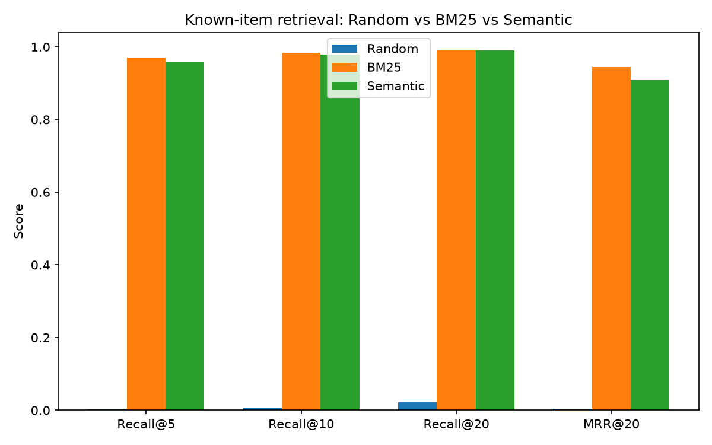

# Semantic Search Engine

A search engine that finds documents by **meaning**, not just keywords, built over ~3,700 arXiv computer science paper abstracts.

Example: a keyword search for "models that learn from a few examples" won't find a paper titled "Few-Shot Learning for X" unless those exact words appear. Semantic search finds it anyway, because it matches meaning instead of exact words.

This project also answers a harder question: **is semantic search actually better than classic keyword search?** It builds both, plus a random baseline, and benchmarks all three head-to-head.

## Results at a glance

412 test queries: search using a paper's title, check whether the system finds that paper.

| System | Recall@5 | Recall@10 | Recall@20 | MRR@20 | Topic coherence@10 |
|---|---|---|---|---|---|
| Random | 0.002 | 0.005 | 0.022 | 0.004 | 0.159 |
| BM25 | 0.971 | 0.983 | 0.990 | 0.944 | 0.450 |
| Semantic | 0.959 | 0.978 | 0.990 | 0.908 | 0.538 |



**Headline finding:** BM25 is slightly better at finding the *exact* paper you're looking for. Semantic search is clearly better at surfacing results that are generally *on-topic*. Neither one wins outright — see [Results](#results) for why.

## Table of contents
- [Problem](#problem)
- [How it works](#how-it-works)
- [Dataset](#dataset)
- [How it's evaluated](#how-its-evaluated)
- [Results](#results)
- [Error analysis](#error-analysis)
- [Limitations](#limitations)
- [How to run](#how-to-run)

## Problem

Keyword search only matches literal words. If you search "models that learn from few examples," it misses a paper about "few-shot learning" unless it contains those exact words.

Semantic search fixes this by converting text into a vector (a list of numbers representing meaning) and comparing vectors instead of words. This project builds one, and rigorously tests it against BM25 — the standard keyword-search algorithm — to see which is actually better, and when.

## How it works

```
Documents (3,292 abstracts)
   |
   v
Sentence Transformer (all-MiniLM-L6-v2)  -->  384-number vector per document
   |
   v
FAISS index (fast nearest-neighbor search)
   |
   v
Query --> embed --> find nearest vectors --> ranked results

Parallel baseline:
Documents --> BM25 (keyword-frequency scoring) --> ranked results
```

All three systems (Random, BM25, Semantic) share the same interface: `build(docs)` then `search(query, k)`, so they can be swapped freely in the evaluation and the demo.

Two separate document sets get built from this same code:
- **Demo set** (`app.py`) — the 3,292 papers a real user would search.
- **Evaluation set** (`evaluate.py`) — the same papers, plus the 412 test papers added in abstract-only form (title removed). Used only for scoring — see below.

Embeddings are cached to disk (`cache/`) so re-running doesn't re-encode ~3,700 abstracts every time.

## Dataset

[`Tiansve/arxiv-cs-subfield`](https://huggingface.co/datasets/Tiansve/arxiv-cs-subfield) on Hugging Face.

- 4,116 arXiv CS papers, split 80/10/10 into train (3,292) / validation (unused) / test (412).
- Balanced across 6 subfields: NLP, ML, computer vision, information retrieval, general AI, statistical ML.
- Each paper has an id, title, abstract, and a category label.
- Downloads and caches automatically on first run — no manual setup.
- **Known limitation:** each paper is forced into a single category label, even though many papers genuinely span two (e.g. an LLM-for-vision paper is both NLP and vision). This is why category matching isn't used as the main way of judging result quality (see below).

## How it's evaluated

**The setup:** for each of the 412 test papers, search using that paper's *title*. Check whether the system finds that exact paper's abstract in the results.

This gives a clear, unambiguous right answer with no manual labeling needed.

**One important detail:** the target paper is indexed using its abstract *only*. If the title were left in, the search query (the title) would appear verbatim inside the very document being searched for, which would hand BM25 a free win that has nothing to do with real search quality. Removing the title forces both systems to actually generalize from how a paper is titled to how it's described.

**Metrics:**
- **Recall@K** — of all 412 queries, what fraction found the right paper in the top K results?
- **MRR@20** — rewards finding the answer *near the top*, not just somewhere in the list. A perfect score (1.0) means the right answer was always ranked #1.
- **Topic coherence@10** (secondary, not a strict relevance measure) — of the top 10 results, what fraction share the query paper's category label? Because categories are single-label but papers aren't, this is treated as a rough signal, not ground truth.

## Results

- **Random** confirms the sanity floor: under 1% recall, as expected for picking documents at random.
- **BM25 slightly beats Semantic** at finding the *exact* right paper (97.1% vs. 95.9% Recall@5). Paper titles often reuse rare, distinctive words straight from their own abstract, which favours BM25.
- **Semantic clearly wins on topic coherence** (53.8% vs. 45.0%). Its results are more likely to be genuinely on-topic, even in the cases where it misses the one exact paper.

Neither system "wins" outright, and that split result is the more interesting finding. See the error analysis below for concrete examples of why each system succeeds or fails.

## Error analysis

Full write-up with real examples: [`results/error_analysis.md`](results/error_analysis.md)

- **BM25 wins** when a title contains a rare acronym or distinctive term that also appears in the abstract (e.g. `GENIUS`, `EMAG`). The embedding model instead maps the title to a broad topic shared by many similar papers, and the one correct match gets buried.
- **Semantic wins** when a title is generic or metaphorical (e.g. "From Word to World"). BM25 either has nothing to latch onto, or gets misled by common words it shares with an unrelated paper, while the embedding still captures the actual topic.

## Limitations

- **No fine-tuning** — the embedding model is used off-the-shelf. Fine-tuning it on this dataset would likely close (or reverse) BM25's lead.
- **Single-label dataset** — see [Dataset](#dataset). The topic coherence metric inherits this noise, which is why it's a secondary signal, not the main score.
- **Measures "can it re-find this exact paper," not general result quality** — chosen because it needs no manual labeling, which is a subjective process.
- **Small dataset** (~3,700 documents) — results may not hold at a much larger scale.

## How to run

```bash
git clone <this-repo-url>
cd semanticsearch

python3 -m venv .venv
source .venv/bin/activate          # .venv\Scripts\activate on Windows
pip install -r requirements.txt

# Sanity-check dataset loading (auto-downloads + caches on first run)
python data.py

# Sanity-check each retrieval engine with manual queries
python random_search.py
python bm25_search.py
python semantic_search.py

# Full evaluation: builds the eval index, runs all 412 known-item queries
# for all 3 systems, writes results/comparison_table.{md,csv},
# results/per_query_results.csv, results/recall_mrr_chart.png
python evaluate.py

# Qualitative error analysis (reads evaluate.py's output)
python error_analysis.py

# Interactive demo
streamlit run app.py

# Unit tests (retrieval engines + eval metric functions, no dataset/model
# download required beyond what's already cached from the steps above)
pip install -r requirements-dev.txt
pytest
```

First run of `evaluate.py` / `app.py` downloads and encodes with `all-MiniLM-L6-v2` (a few seconds on CPU); later runs reuse the cached embeddings in `cache/`.